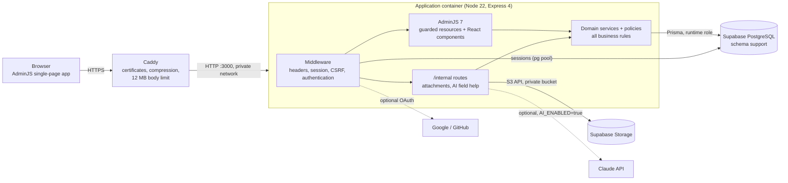
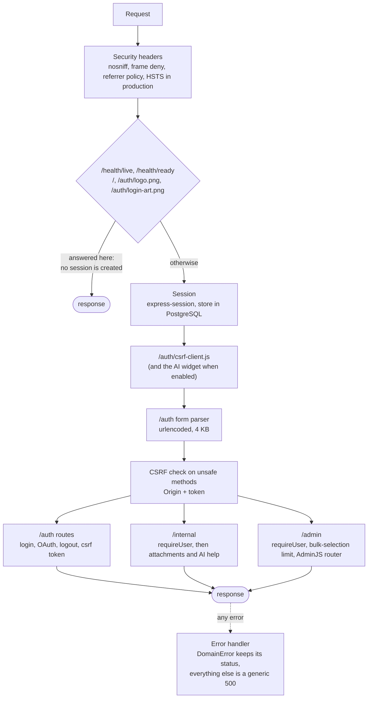
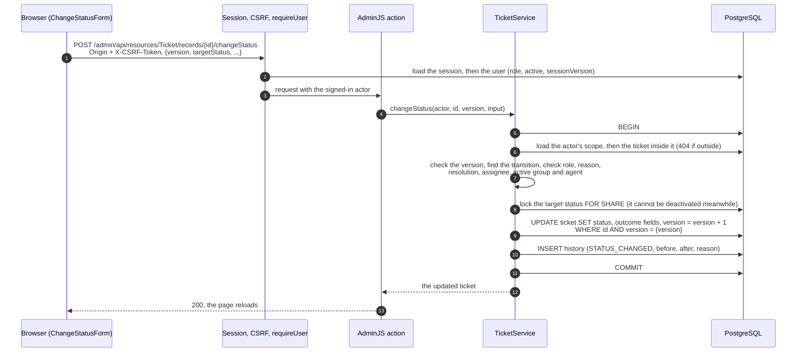

# Architecture

How the application is put together: the parts, the order a request passes through them, and where each rule lives.
Diagrams are [Mermaid](https://mermaid.js.org/); GitHub draws them. Related: [database](database.md),
[authentication](authentication.md), [workflow](workflow.md), [deployment and operations](operations.md),
[decisions](decisions.md).

## The parts



| Part | Responsibility |
| --- | --- |
| **Caddy** | Terminates HTTPS (certificate from Let's Encrypt, renewed by itself), redirects HTTP to HTTPS, compresses, caps the request body at 12 MB, takes an unhealthy instance out of rotation using `/health/live`. The application has no published port. |
| **Express app** (`src/app.ts`) | Assembles the middleware in a fixed order (below), mounts the sign-in routes, the internal API and AdminJS, and turns every error into a JSON answer without leaking details. |
| **AdminJS** (`src/admin`) | The screens. Resources are `GuardedResource` wrappers: reads are scoped to the person's groups, writes go through domain services, the generic delete is switched off. Custom React components draw the ticket header, inline comments, history, and the status, assign and bulk forms. |
| **Domain** (`src/domain`, `src/policies`) | Services (`TicketService`, `CommentService`, `AttachmentService`, `UserService`, ...) own every business rule and run each operation in one transaction. Policies are pure functions of the actor and the data (`ticket-policy.ts`, `comment-policy.ts`). |
| **Storage** (`src/storage`) | An `ObjectStorage` interface with an S3 implementation (Supabase) and an in-memory one for development and tests. |
| **Assistant** (`src/assistant`) | Optional AI field help; off unless `AI_ENABLED=true` (D-025). |
| **CLI** (`src/cli`) | Operator commands compiled into the image: create an administrator, seed the reference data and the demo dataset, check or reconcile storage, provision database roles, smoke test. |

## The request pipeline

The order is fixed in `src/app.ts` and matters: each step relies on the ones before it.



`requireUser` reloads the user from the database on every request. That is what makes a deactivation, a role change or a
password change effective immediately (see [authentication](authentication.md)).

## Where a rule lives

A rule is checked at the layer that owns it, and the layers above only *offer* what the layer below will accept:

| Layer | What it does | Can it be bypassed? |
| --- | --- | --- |
| Screens (React, AdminJS options) | Hide buttons and fields, offer only the valid choices | Yes, by a hand-made request. It is a convenience, not a control. |
| `GuardedResource` | Applies the person's scope to every read (list, count, search, show, reference lookups); refuses writes that have no service handler | No: AdminJS cannot reach the table except through it. |
| Domain services | Role, scope, workflow, validation (Zod, strict objects), optimistic locking, history | No: the only code that writes. |
| Database | Foreign keys with `ON DELETE RESTRICT`, unique indexes, `FOR SHARE` / `FOR UPDATE` row locks, a runtime role without DDL rights | The last line: even a bug in the application cannot drop a table or delete a referenced row. |

## One operation end to end: changing a ticket's status



If any step fails, the transaction rolls back and the person gets the error on the form: a refused rule is a 422 with the
field names, a stale version is a 409, an out-of-scope ticket is a 404 (existence is not disclosed).

The edit form's Status field takes the same path: `TicketService.updateWithStatus` runs this change and the field edits in
one transaction (D-027). Bulk change applies the same function to up to 100 tickets in one transaction (D-016).

## Source layout

```
src/
  app.ts, server.ts          assembly and start-up
  config/env.ts              the whole configuration, validated once at start-up
  auth/                      login, sessions, CSRF, OAuth, password hashing, requireUser
  admin/                     AdminJS resources, field catalog, React components (components/)
  domain/                    services and queries: tickets, comments, attachments, customers, groups, users, statuses
  policies/                  pure access rules (scope, comment permissions)
  http/                      security headers, upload and bulk limits, /internal routes
  storage/                   object storage (S3, in-memory), file validation, reconcile
  assistant/                 optional AI field help
  ops/, cli/, seed/          database roles, operator commands, the demo dataset
prisma/                      schema and migrations
public/                      the CSRF client script, the AI widget, logo and sign-in picture
deploy/vps/                  compose.yaml, Caddyfile, deploy.sh, bootstrap.sh, operator tools
tests/                       unit and integration suites
```

## Why these choices

The reasoning, with the alternatives that were considered, is in [decisions.md](decisions.md). The ones that shape the
structure: business rules in services and policies instead of AdminJS hooks (D-009), guarded resources (D-010), one
login controller with sessions in PostgreSQL, so a restart signs nobody out (D-006), CSRF (D-007), two database roles on
Supabase (D-020), delivery to a VPS behind Caddy (D-022).
