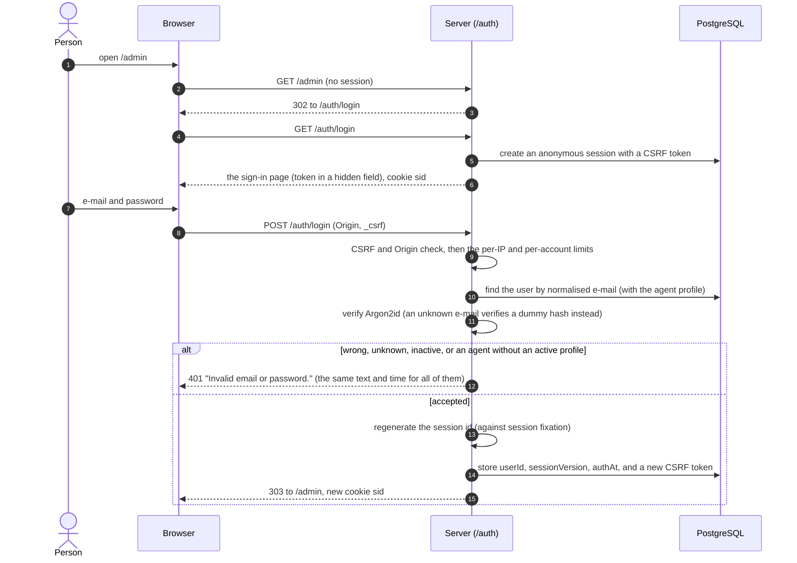
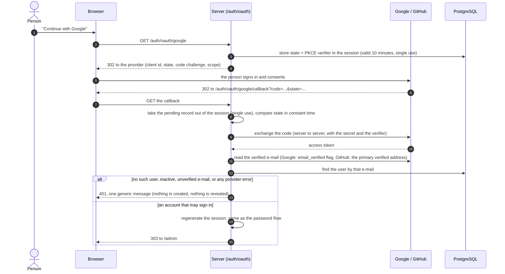
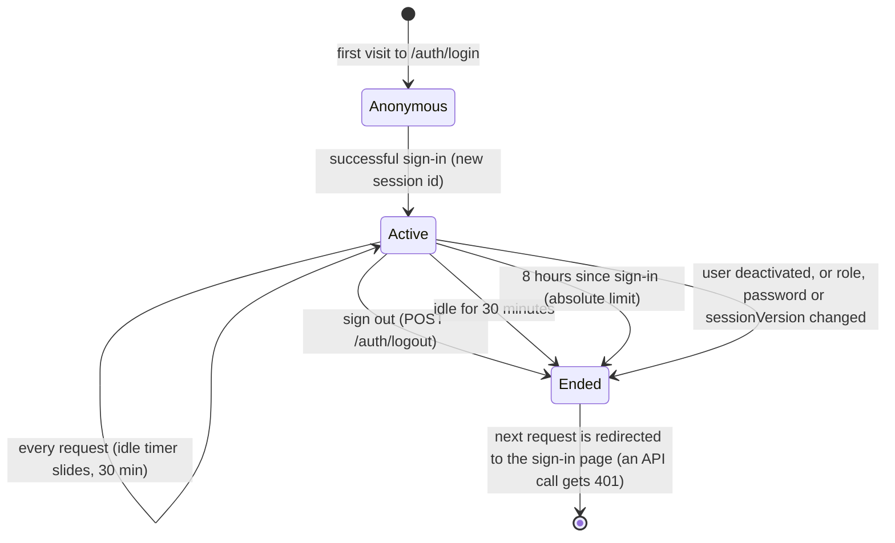

# Authentication and access control

Who can sign in, how a session lives, and what each role can reach. The code is in `src/auth/`, the rules in
`src/policies/` and the domain services. Related: [architecture](architecture.md), [database](database.md),
[decisions](decisions.md) (D-006, D-007, D-008, D-026).

## The two roles

| | ADMIN | AGENT |
| --- | --- | --- |
| Tickets | all of them | only those of the groups the agent belongs to |
| Create tickets | in any group | in own groups only |
| Status changes | every transition, including closing (`RESOLVED` to `CLOSED`) and reopening a closed ticket | every transition except the two admin-only ones |
| Comments | edit any comment | edit only own comments |
| Customers | create and edit | create and read |
| Users, agents, groups, statuses | manage (menu "Administration") | not shown, API answers 403 |
| Agent profile | none; has no "My open tickets" | required: an AGENT without an active profile cannot sign in |

Nobody can raise their own role, deactivate their own account, or leave the system without an active administrator: the
last active ADMIN cannot be demoted or deactivated (checked under a lock, so two simultaneous attempts cannot both succeed).
There is no self-registration: an administrator creates every account (the first one with `npm run admin:create` or
`./tools/admin-create.sh`).

## Signing in with a password

Details that matter:

- **Passwords** are hashed with Argon2id (m = 19 456 KiB, t = 2, p = 1, the OWASP minimum) and are 12 to 256 characters.
  An unknown e-mail is verified against a dummy hash, so unknown e-mail and wrong password take the same time and give the
  same message; the sign-in page never reveals which accounts exist. The parameters are to be revisited against the
  production CPU (D-008).
- **E-mail** is lower-cased and trimmed before lookup (`normalizedEmail`).
- **Limits** (in memory, one replica): 20 attempts per IP and 5 *failed* attempts per account in a 15-minute window
  (`LOGIN_MAX_PER_IP`, `LOGIN_MAX_FAILED_PER_ACCOUNT`, `LOGIN_WINDOW_MINUTES`). A blocked attempt gets 429 and the same page.
  A successful sign-in does not count against the account.
- The first attempt after a server restart can fail with "forbidden" when the browser still holds a token from the old
  session; simply try again.

## Signing in with Google or GitHub (optional)

Each provider is on when its client id and secret are both set (`GOOGLE_CLIENT_ID/SECRET`, `GITHUB_CLIENT_ID/SECRET`); one
without the other stops the application at start-up. The sign-in page then shows a button per provider. It is the
authorization code flow with PKCE (`S256`) and a one-time `state`, and it only opens an account that **already exists**
(D-026).

Nothing is created and no role comes from the provider. The callback addresses to register at the provider are
`<PUBLIC_URL>/auth/oauth/google/callback` and `<PUBLIC_URL>/auth/oauth/github/callback`; the provider's secret never
reaches the browser. A person whose provider address differs from the account's e-mail cannot use that provider until an
administrator changes the account's e-mail.

## The life of a session

Sessions are server-side, in the `Session` table of PostgreSQL; the browser holds only an opaque id in the cookie `sid`
(`HttpOnly`, `SameSite=Lax`, `Secure` in production).

On **every** request to `/admin` or `/internal`, `requireUser` checks, in this order: a session with a user id exists; it is
younger than `SESSION_ABSOLUTE_HOURS` (8); the user still exists; its `sessionVersion` equals the one stored at sign-in; and
the user is still allowed to sign in (active, and an AGENT with an active profile). Any failure destroys the session. The user
is loaded fresh each time, so role changes, deactivation and password changes take effect on the next request without any
cache to expire.

**What bumps `sessionVersion`** (and so signs the person out everywhere): a change of role, a new password, and
deactivation. "Sign out everywhere" is also available to an administrator for any account.

**Settings:** `SESSION_IDLE_MINUTES` (30), `SESSION_ABSOLUTE_HOURS` (8), `SESSION_SECRET` (at least 32 characters, never
the placeholder in production).

## CSRF

State-changing requests (anything except `GET`, `HEAD`, `OPTIONS`) need both:

1. an `Origin` header equal to the application's own origin (`PUBLIC_URL`), and
2. the session's token, in the `X-CSRF-Token` header (AdminJS calls, patched by `public/csrf-client.js`) or in the hidden
   `_csrf` field (the plain sign-in and sign-out forms), compared in constant time.

The token is created with the session and fetched by the admin client from `GET /auth/csrf`, which answers only same-origin
requests and is never cached. A failed check is a 403 and the request body is discarded unread (D-007).

## Authorization, level by level

1. **The signed-in user** is loaded and validated on every request (above).
2. **Screens** hide what the role cannot use: the menu, resources, buttons, and the status choices. This is a convenience only.
3. **Resources** (`GuardedResource`) add the person's group scope to every read: list, count, search, show, and the lookups
   behind reference fields. A query string can narrow the result but never widen it.
4. **Services** check role and scope again in every call, inside the transaction: `ticketScopeWhere`, `canAccessGroup`,
   `requireAdmin`, the comment policy. A ticket outside the person's groups answers **404**, the same as one that does not
   exist, so ids reveal nothing.
5. **The database** refuses what the application's role cannot do at all: no DDL, no deletes of referenced rows.

Attachments and the optional AI help are mounted under `/internal` behind the same session, CSRF and `requireUser` chain.
A download is authorised first (scope, then the comment's ticket) and then redirects to a presigned URL that lives for 60
seconds; the bucket is private.

## Sign-out

`GET /auth/logout` only shows a confirmation page (AdminJS draws logout as a link); `POST /auth/logout` destroys the session
and clears the cookie. A sign-out therefore cannot be triggered by a link or an image on another site.

## What is not covered

Limits are counted in memory, so they hold for one replica and reset on restart (D-008). There is no multi-factor
authentication, no password-reset e-mail (an administrator sets a new password, which signs the person out everywhere), and
no audit of sign-ins beyond the application log.
