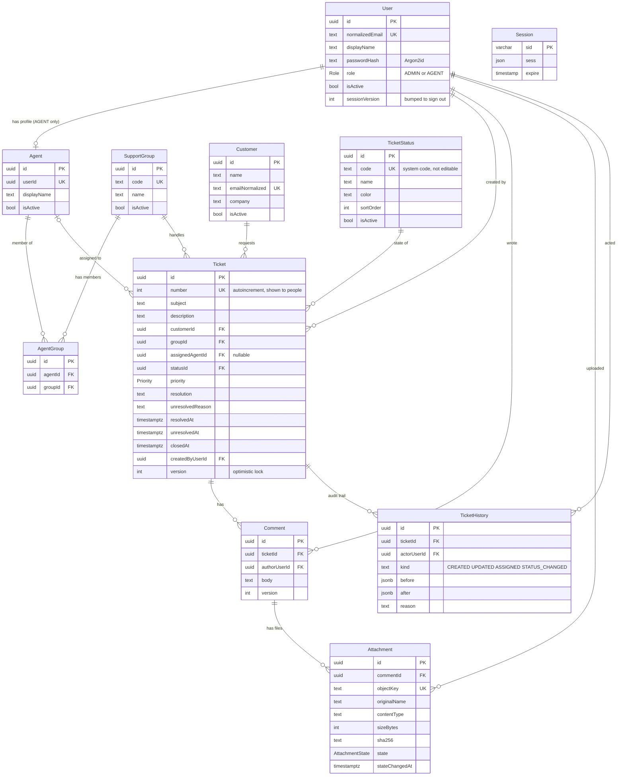
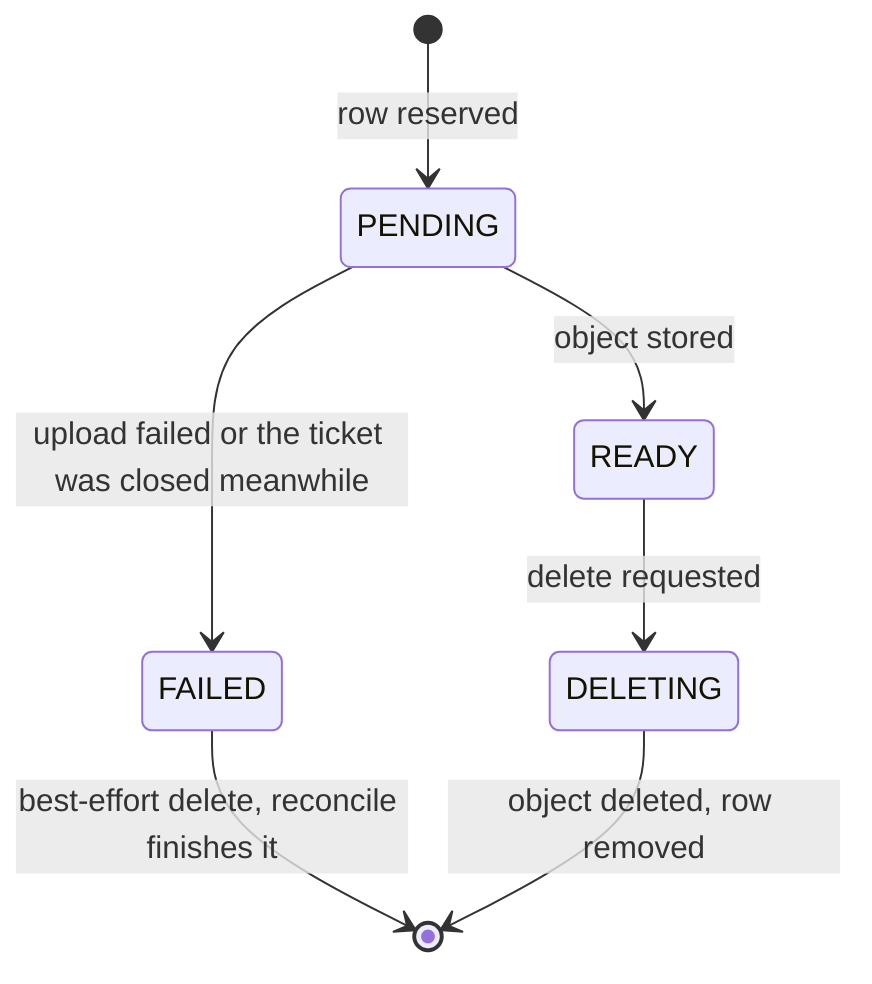

# Database

The data model, how it is protected, and how it changes. The schema is `prisma/schema.prisma`; the SQL that creates it
is in `prisma/migrations/`. Related: [architecture](architecture.md), [workflow](workflow.md),
[authentication](authentication.md), [operations](operations.md).

PostgreSQL 17 (Supabase in production, an embedded instance for development), one schema named `support`. Every table is
named after its Prisma model, in CamelCase, so it has to be quoted in SQL: `support."Ticket"`.

## Entity relationships

`Session` has no relations: the session store (`connect-pg-simple`) keeps its own rows, and the user id lives inside the
session data. Timestamps (`createdAt`, `updatedAt`) are `timestamptz` on every table that has them and are left out of
the diagram.

## Tables

| Table | Holds | Notes |
| --- | --- | --- |
| `User` | A staff account: e-mail (lower-cased, unique), display name, Argon2id password hash, role, active flag, `sessionVersion` | Customers are not users; there is no customer login. |
| `Agent` | The working profile of an AGENT user: one per user | An ADMIN has none. An AGENT without an active profile cannot sign in. |
| `SupportGroup` | A team that owns tickets: unique `code`, name, description, active flag | Defines the scope of its members. |
| `AgentGroup` | Membership: which agent belongs to which group | Unique per (agent, group). |
| `Customer` | The person who raised a request: name, unique normalised e-mail, company, phone | A directory shared by staff, not a tenant boundary. |
| `TicketStatus` | The six system statuses | `code` is fixed and drives the workflow; name, colour and order are editable; `NEW` cannot be deactivated, and a status that tickets use cannot be deactivated. |
| `Ticket` | The request: subject (5 to 200 characters), description (up to 1000), customer, group, assignee, status, priority, outcome fields, creator, `version` | `number` is a sequence value people refer to ("Ticket #123"). |
| `Comment` | A note on a ticket: body (up to 5000 characters), author, `version` | Never deleted; edited by its author or an admin. |
| `Attachment` | A file of a comment: the key in the bucket, original name, type, size, SHA-256, `state` | The bytes are in Storage, never in the database. |
| `TicketHistory` | The audit trail: who did what and when, with `before` and `after` snapshots | Written in the same transaction as the change. |
| `Session` | Server-side sessions | Expired rows are pruned every 15 minutes. |

Enumerations: `Role` (`ADMIN`, `AGENT`), `Priority` (`LOW`, `NORMAL`, `HIGH`, `URGENT`), `AttachmentState` (`PENDING`,
`READY`, `FAILED`, `DELETING`).

### Ticket outcome fields

| Status reached | `resolution` | `unresolvedReason` | `resolvedAt` | `unresolvedAt` | `closedAt` |
| --- | --- | --- | --- | --- | --- |
| `RESOLVED` | set | cleared | now | cleared | cleared |
| `UNRESOLVED` | cleared | set | cleared | now | cleared |
| `CLOSED` | kept | kept | kept | kept | now |
| anything else (including reopening) | cleared | cleared | cleared | cleared | cleared |

What was cleared stays readable in `TicketHistory.before`. The ticket's age on screen is derived from these dates and is
not stored.

### History entries

`TicketHistory.kind` is one of `CREATED`, `UPDATED`, `ASSIGNED`, `STATUS_CHANGED`. `before` and `after` hold the same
snapshot of the ticket (subject, description, priority, status code, group, assignee, outcome fields; dates as ISO
strings), so the screen can show exactly what changed. `reason` carries the reason given for a status change. A comment
change is not a ticket history entry; comments have their own `version`.

## Integrity

- **Foreign keys** are all `ON DELETE RESTRICT`: a customer, group, agent, status or user that something refers to cannot
  be removed. Records are deactivated, never deleted; the application has no delete action at all.
- **Unique indexes:** user e-mail, customer e-mail, group code, status code, ticket number, agent per user, membership per
  (agent, group), attachment object key.
- **Secondary indexes** serve the screens: tickets by (group, status, updated), (assignee, status, updated) and
  (customer, created); comments by (ticket, created); history by (ticket, created); attachments by comment; sessions by
  expiry. Lists, counts and search were checked with 2000 tickets (and the demo seed can build far more, D-023).
- **Validation** is done in the services with strict Zod schemas (unknown fields are refused, not ignored). The database
  holds no `CHECK` constraints: lengths and workflow rules are the services' job, and the single writer is the
  application's runtime role.

## Concurrency

Two mechanisms keep simultaneous edits honest (D-009, D-016):

- **Optimistic locking.** Tickets and comments carry `version`. An update is `UPDATE ... WHERE id = ? AND version = ?`
  with `version = version + 1`; if no row matches, someone else saved first and the person gets a 409 instead of
  overwriting. The edit form remembers the version it was opened with, and the bulk form remembers one per ticket.
- **Row locks inside the transaction.** A change that depends on another row locks it so that row cannot change
  underneath: `FOR SHARE` on the target status, the group and the agent when a ticket is assigned or moved, and `FOR UPDATE`
  when an admin deactivates or removes one of them (which then counts the tickets that still use it). Adding a comment
  locks the ticket row `FOR UPDATE` (so it cannot be closed in the middle) and bumps the ticket's `updatedAt`, but not its
  `version`. Locks are taken in a
  fixed order (group, then agent), and bulk changes visit tickets in sorted id order, so two overlapping operations cannot
  deadlock.

## Attachment states

The database row and the stored file are two systems without a shared transaction, so every change is ordered to be
recoverable, and `storage:reconcile` finishes whatever a crash left half-done (D-015):

Upload: a `PENDING` row, then the object, then `READY`. Delete: `DELETING`, then the object, then the row. Reconcile (a
nightly workflow, and `npm run storage:reconcile`) removes stale `PENDING`, `FAILED` and `DELETING` rows, objects with no
row and rows with no object. It ages a row from `stateChangedAt`, so a long-lived file that was just marked `DELETING`
is not mistaken for an abandoned operation.

## Database roles and privileges

Production uses two roles (D-020), created by `npm run db:provision` with the project owner's connection:

| Role | Owns | Used by | Can |
| --- | --- | --- | --- |
| `migrator` | the schema `support` and everything in it | `prisma migrate deploy` only (`DIRECT_URL`, a GitHub secret) | create and change tables |
| `app_runtime` | nothing | the running application (`DATABASE_URL`, on the server) | `SELECT`, `INSERT`, `UPDATE`, `DELETE` on the tables and `USAGE`, `SELECT`, `UPDATE` on the sequences; no DDL, no `CREATE`, not a superuser |

Default privileges are set so that tables the migrator creates later are usable by the runtime role without a new grant.
Supabase's own API roles (`anon`, `authenticated`, `service_role`) have no access to the schema, and `support` must stay
out of Supabase's *Exposed schemas* so the Data API cannot reach it. `db:provision` verifies all of this and prints a
check list (never a password). Passwords are 24 characters or more and live only in the host's secret store and the
GitHub environment.

## Migrations

`prisma/migrations/` holds the history; the schema in use is chosen by the connection URL (`?schema=support`), so the SQL
uses unqualified names.

| Migration | Adds |
| --- | --- |
| `20261010143928_init` | enums, all tables, indexes and foreign keys |
| `20261011090000_attachment_state_changed_at` | `Attachment.stateChangedAt`, for aging reconcile candidates |

A deployment applies them with `npx prisma migrate deploy` under the migrator role, then makes sure the six system statuses
exist (`seed:reference`, safe to repeat). Prisma records applied migrations in `support._prisma_migrations`. In development
use `npx prisma migrate dev`.

If a deployment fails on a migration that says an object *already exists*, the database and `_prisma_migrations` disagree
(for example the tables were created or cleaned by hand). Do not edit the migration: look at what exists, then either remove
the leftovers and the failed record, or tell Prisma the migration is already applied with `prisma migrate resolve --applied
<name>`. Never run `migrate reset` or `db push` against production.

## Reference data and the demo dataset

The six system statuses are reference data, created by `seed:reference` and by every deployment. Everything else is
created through the application. For demonstrations, `seed:demo` builds a deterministic dataset (accounts, customers,
tickets with history, comments, files) and `seed:reset` removes exactly the rows and files it created (D-017, D-023).
