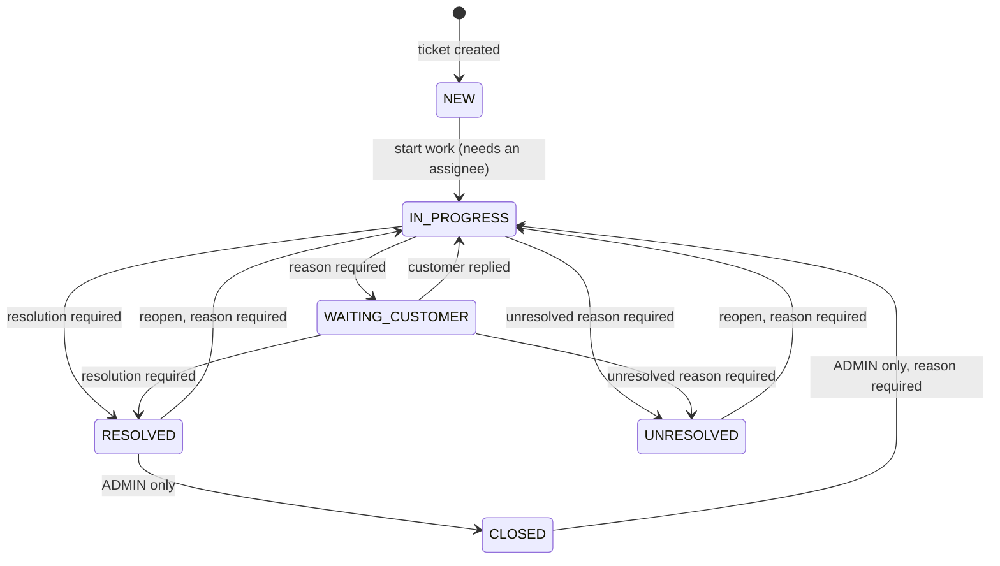

# Ticket workflow and working rules

What can happen to a ticket, who may do it, and what each step needs. The rules are in `src/domain/tickets/workflow.ts`
(pure functions, no database) and are applied by `TicketService`; the screens only offer what the server will accept.
Related: [database](database.md) (what is stored), [authentication](authentication.md) (roles), [architecture](architecture.md).

## Statuses

| Code | Shown as | Meaning | Kind |
| --- | --- | --- | --- |
| `NEW` | New | Raised, not yet worked | active |
| `IN_PROGRESS` | In progress | An agent is working on it | active |
| `WAITING_CUSTOMER` | Waiting for customer | Work is paused until the customer replies | active |
| `RESOLVED` | Resolved | A fix was found and recorded; waiting for an admin to close it | solved |
| `UNRESOLVED` | Unresolved | Work stopped without a solution; the reason is recorded | frozen |
| `CLOSED` | Closed | Confirmed and finished | solved, frozen |

The codes are fixed and drive the rules; an administrator can change the display name, colour and order, or deactivate a
status that no ticket uses (`NEW` cannot be deactivated).

## Transitions

Anything not drawn is refused (`invalid_transition`, HTTP 422): for example `NEW` cannot go straight to `RESOLVED`, and
`CLOSED` cannot go anywhere except back to `IN_PROGRESS` by an administrator.

| From | To | Who | Reason | Also required |
| --- | --- | --- | --- | --- |
| `NEW` | `IN_PROGRESS` | admin, agent | optional | an active agent of the ticket's active group as assignee |
| `IN_PROGRESS` | `WAITING_CUSTOMER` | admin, agent | **required** | an assignee |
| `WAITING_CUSTOMER` | `IN_PROGRESS` | admin, agent | optional | an active group member as assignee |
| `IN_PROGRESS` | `RESOLVED` | admin, agent | optional | **resolution** (10 to 2000 characters), an assignee |
| `WAITING_CUSTOMER` | `RESOLVED` | admin, agent | optional | **resolution**, an assignee |
| `IN_PROGRESS` | `UNRESOLVED` | admin, agent | optional | **unresolved reason** (10 to 2000), an active group member |
| `WAITING_CUSTOMER` | `UNRESOLVED` | admin, agent | optional | **unresolved reason**, an active group member |
| `UNRESOLVED` | `IN_PROGRESS` | admin, agent | **required** | an active group member |
| `RESOLVED` | `IN_PROGRESS` | admin, agent | **required** | an active group member |
| `RESOLVED` | `CLOSED` | **admin only** | optional | nothing about the assignee (an admin may close a ticket whose agent has since left) |
| `CLOSED` | `IN_PROGRESS` | **admin only** | **required** | an active group member |

The reason is free text (up to 2000 characters) saved in the ticket history. The resolution and the unresolved reason are
saved on the ticket itself (see the outcome fields in [database](database.md)); each is accepted only for the matching
target and is refused otherwise.

### Assignee rules

- **An active group member** means an active agent who belongs to the ticket's group, and the group itself must be active.
  Starting work, reopening, and marking a ticket unresolved all require one. When the ticket's assignee no longer
  qualifies (the agent was deactivated, or left the group), the same request can name another: the status form offers
  the group's active agents and sends the new assignee atomically with the change.
- **Reassignment on a transition** (a group or assignee sent together with the status) is refused for transitions where it
  does not apply, such as closing.
- **Assigning** on its own (the *Assign* action) changes the group and the assignee. A new assignee must be an active member
  of the (new, active) group, and the assignee can be cleared only while the ticket is `NEW`.
- An AGENT can move a ticket only to groups they belong to.

### Frozen tickets

`CLOSED` and `UNRESOLVED` tickets cannot be edited, reassigned or commented on until they are reopened
(`ticket_frozen`, HTTP 409). Reopening is the transition to `IN_PROGRESS` with a reason; from `CLOSED` it is admin-only.

## Editing

- The **edit form** changes subject, priority and description, and the **Status** field offers the current status and the
  transitions the person may make. A change of status chosen there asks for what it needs and is saved together with the
  other edits in one transaction (D-027). The customer cannot be changed after creation; the group and assignee are changed
  with the Assign action.
- **Change status** is the same transition on its own, and **Bulk change status** applies one transition to up to 100
  selected tickets, all or nothing, naming every refused ticket (D-016). A bulk change to `UNRESOLVED` needs a confirmation
  that one shared reason is right for every ticket.
- Every edit carries the `version` it started from. If the ticket changed meanwhile, the save is refused with a message to
  refresh, instead of overwriting (see Concurrency in [database](database.md)).
- Every change writes one history entry in the same transaction: `CREATED`, `UPDATED`, `ASSIGNED` or `STATUS_CHANGED`, with
  the ticket before and after, the person, the time and the reason.

## Comments and attachments

- **Add:** any staff member who can see the ticket, except on `CLOSED` and `UNRESOLVED` tickets. Plain text of 1 to 5000
  characters, shown escaped, never as HTML. Adding a comment moves the ticket up in "recently updated" lists.
- **Edit:** the author, or any admin; never on a frozen ticket. Comments cannot be deleted, by design.
- **Attachments** belong to a comment and follow the same rule as editing it: who may edit the comment may add or remove its
  files. Limits: one file per upload, 10 MiB, at most 5 per comment; PNG, JPEG, PDF or UTF-8 text. The type is decided from
  the bytes: the extension, the declared type and the content must all agree, and SVG, HTML and archives are refused. A file
  uploaded while the ticket is being closed is discarded rather than attached.
- **Download** is authorised against the ticket's scope first, then redirects to a presigned address that works for 60
  seconds; the bucket itself is private.

## Customers, groups, agents, statuses

- **Customers** form a directory shared by staff: any staff member can add one, only an admin can edit or deactivate. A
  deactivated customer cannot get new tickets. An agent sees customers' names and e-mails but cannot reach out-of-scope
  tickets through them.
- **Groups and memberships:** an admin manages them. A group that has active tickets cannot be deactivated, and a member who
  still holds active tickets of that group cannot be removed.
- **Agents:** an agent who holds active tickets (`NEW`, `IN_PROGRESS`, `WAITING_CUSTOMER`) cannot be deactivated until
  they are reassigned. Tickets that are `RESOLVED`, `CLOSED` or `UNRESOLVED` do not count.
- **Statuses:** see above. Deactivating one is refused while tickets use it.

These checks run under row locks, so a concurrent assignment cannot sneak a ticket onto an agent who is being deactivated.

## Screens that follow from the rules

| Screen | What it shows |
| --- | --- |
| Dashboard | The agent's own queue; counts for the person's scope, each linking to the matching filtered list; open tickets by group and by agent split by status |
| Tickets | Queue tabs (Open by default, My open, Unassigned, Waiting for customer, All), search, filters (including "any status except Closed" and "unassigned"), sorting, pagination, bulk selection (status, assignee, group, priority) |
| Ticket page | Heading with the number and subject; the description and the outcome; one activity feed of comments (with their files) and history; the reply editor; the properties as dropdowns that save when changed |
| Edit / Assign / Change status | The forms described above; the ticket page offers the simple changes without leaving it |
